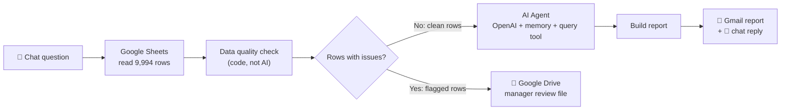

# 📊 Velora Superstore: Sales & Profit Analysis
### Power BI dashboard + AI reporting assistant on a 9,994-row retail dataset

**Python · SQL · Power BI · DAX · n8n · OpenAI**

---

## In 30 seconds

| | |
|---|---|
| **Business problem** | High revenue does not always mean high profit. Which products lose money, is discounting sustainable, and which regions turn sales into profit? |
| **What I built** | **Part 1:** Python cleaning and EDA, SQL business questions, DAX measures and a 3-page Power BI dashboard. **Part 2:** an n8n AI assistant where a manager asks a question in plain English and gets a report by email, with an automatic data quality gate and a live interactive dashboard. |
| **Dataset** | 9,994 retail order lines, 2014–2017 (sales, profit, discount, category, region, segment) |
| **Outcome** | Showed where the business makes and loses money, and turned the analysis into a self-serve tool that does not need a BI license or an analyst |

## Headline numbers

| **$2.30M** | **$286K** | **12.4%** | **17.40%** |
|:---:|:---:|:---:|:---:|
| Total sales | Total profit | Profit margin | Technology margin (best category) |

Other results from the analysis: loss-making categories identified, the effect of discounting on profit measured, and regional and seasonal trends compared. Full write-up: [dashboard and insights report](dashboard%20and%20insights.pdf).

---

## Part 1: Analysis and Power BI dashboard

**Process:** raw CSV → cleaning and EDA in Python → 10+ business questions in SQL → measures in DAX → 3-page Power BI dashboard.

**Page 1: Executive Sales & Profit Performance**

**Page 2: Profitability & Risk Analysis**

**Page 3: Insights & Recommendations**

---

## Part 2: AI analytics assistant (n8n)

Part 1 answers the questions I thought of. Part 2 lets a manager ask **their own** questions and receive a report in their inbox, without opening a BI tool.

**Why it is built this way**
- **The AI never touches bad data.** Validation is plain, deterministic code. It flags problems and never edits the original data.
- **Flagged rows go to a human.** In the full run, **9,994 rows in → 9,986 clean rows to the AI → 8 flagged rows** sent to a Google Drive review file with the exact issue listed for each row.
- **The manager stays in control.** Each flagged row can be fixed, marked *Approved*, or marked *Rejected* in the source sheet.
- **Delivery matches how managers work.** The answer comes back in chat, and an HTML report with findings and recommendations is emailed through Gmail.

Checks covered: missing values, duplicates, date problems, impossible values (negative sales, discount outside 0–1, profit above sales), text in number fields, and extreme values.

Workflow screenshots, the importable JSON files and the full list of checks are in [`n8n-AI-Automation/`](n8n-AI-Automation/).

---

## Interactive dashboard

### 🔴 [Open the live dashboard](https://i-ashish-07.github.io/Velora-Superstore-Project/)

- KPI cards for sales, profit, margin, units and the share of loss-making order lines
- **Red highlighting wherever money is lost** (profit lines, bars, KPI cards, table rows)
- Filters for year, region, category and segment, plus click-to-filter on any chart
- Trend, sub-category, region, segment and discount-impact charts
- Top 10 by profit, top 10 by sales and bottom 10 by profit
- Auto-generated key insights and business recommendations, with light and dark mode

> The hosted page is a snapshot of the data at export time. The n8n dashboard workflow regenerates it from the sheet.

---

## Skills demonstrated

| Skill | Where to see it |
|---|---|
| Data cleaning and EDA | [`e-commerce_projectt.ipynb`](e-commerce_projectt.ipynb) |
| SQL for business questions | [`superstore questions.sql`](superstore%20questions.sql) |
| Dashboard design, DAX, KPIs | [`Velora Superstore Dashboard.pbix`](Velora%20Superstore%20Dashboard.pbix) |
| Business storytelling | [`dashboard and insights.pdf`](dashboard%20and%20insights.pdf) |
| Workflow automation and AI agents | [`n8n-AI-Automation/`](n8n-AI-Automation/) |
| Data quality and governance | Data quality gate and manager review loop |

## Tech stack

| Area | Tools |
|---|---|
| Analysis | Python (Pandas, Matplotlib, Seaborn), Jupyter, SQL |
| BI | Power BI Desktop, DAX, Power Query |
| Automation and AI | n8n (chat trigger, webhooks, sub-workflows), OpenAI agent with memory |
| Delivery | Gmail, Google Sheets, Google Drive |
| Web | JavaScript, HTML/CSS, Chart.js, GitHub Pages |

## Known limitation

The query tool the AI agent calls reads the full sheet. Applying the same validation inside it would make every AI answer use only validated rows. This is the next improvement.

---

**Ashish Kumar Mahato** · Data Analyst · [LinkedIn](https://www.linkedin.com/in/ashish-k7/) · [GitHub](https://github.com/i-ashish-07) · ashishmahato90083@gmail.com
