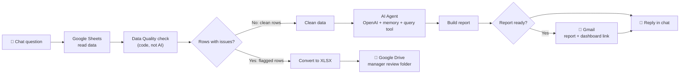

<div align="center">

# 📊 Velora Superstore
### From raw retail data to boardroom insights — and an AI assistant that delivers them

**Python · SQL · Power BI · n8n · OpenAI · Google Workspace**

[](https://i-ashish-07.github.io/Velora-Superstore-Project/)

</div>

---

## 🎯 What this project shows

An end-to-end analytics project on 2014–2017 retail transactions, built in two connected parts:

| Part | Question it answers | What I built |
|---|---|---|
| **1. Analysis & BI** | *Where does the business make or lose money?* | Python cleaning and EDA, SQL business questions, a 3-page Power BI dashboard |
| **2. AI automation** | *Can a manager just ask and get a trusted answer?* | An n8n chat assistant with a data-quality gate, emailed reports, a manager review file, and a live interactive dashboard |

**Skills demonstrated:** data cleaning · data validation · SQL · DAX · dashboard design · business storytelling · workflow automation · AI agents with guardrails

---

## 🔗 Quick Links

| | |
|---|---|
| 🔴 **Live interactive dashboard** | [Open the dashboard](https://i-ashish-07.github.io/Velora-Superstore-Project/) |
| 🤖 **n8n automation (workflows + screenshots)** | [`n8n-AI-Automation/`](n8n-AI-Automation/) |
| 🎥 **Demo video** | _add your YouTube / Drive link_ |
| 📄 **Dashboard & insights report** | [dashboard and insights.pdf](dashboard%20and%20insights.pdf) |
| 🖼 **LinkedIn carousel** | [velora_linkedin_carousel.pdf](velora_linkedin_carousel.pdf) |

## 📑 Contents
1. [Business problem](#1-business-problem)
2. [Part 1 – Analysis & Power BI dashboard](#2-part-1--analysis--power-bi-dashboard)
3. [Part 2 – AI analytics assistant (n8n)](#3-part-2--ai-analytics-assistant-n8n)
4. [Data quality gate and manager review](#4-data-quality-gate-and-manager-review)
5. [Interactive HTML dashboard](#5-interactive-html-dashboard)
6. [Tech stack](#6-tech-stack)
7. [Repository structure](#7-repository-structure)
8. [Design decisions, limitations and next steps](#8-design-decisions-limitations-and-next-steps)

---

## 1. Business problem

> **High revenue does not always mean high profitability.**

An e-commerce retailer wants to know whether its sales are profitable, which products destroy margin, whether discounts are sustainable, and which regions turn sales into profit efficiently.

**Key questions answered**
1. What is the overall sales and profit performance?
2. Which category drives the most revenue, and which has the best margin?
3. Which sub-category contributes most to losses?
4. Does discounting improve or damage profitability?
5. Which region converts sales into profit most efficiently?
6. What are the monthly seasonal trends in sales and profit?

### Key findings
> _Replace the blanks with your real numbers from the Power BI dashboard._

- **Overall:** sales of `___`, profit of `___`, margin of `__%`
- **Top category by revenue:** `___` | **Best margin:** `___`
- **Loss-making sub-categories:** `___`
- **Discounting:** orders discounted above `__%` lose money
- **Best region:** `___` | **Weakest region:** `___`
- **Seasonality:** sales peak in `___`

---

## 2. Part 1 – Analysis & Power BI dashboard

**Process:** raw CSV → cleaning and EDA in Python → business questions in SQL → measures in DAX → 3-page Power BI dashboard.

**Page 1 – Executive Sales & Profit Performance**

[](Screenshot%202026-05-27%20123435.png)

**Page 2 – Profitability & Risk Analysis**

[](Screenshot%202026-05-27%20123447.png)

**Page 3 – Insights & Recommendations**

[](Screenshot%202026-05-27%20204418.png)

**Dataset:** Superstore retail data (2014–2017): order date, sales, profit, discount, category and sub-category, region, ship mode, customer segment.

---

## 3. Part 2 – AI analytics assistant (n8n)

Part 1 gives answers to the questions I thought of. Part 2 lets a manager ask **their own** questions in plain English and get a report in their inbox, without opening a BI tool.

### How it works



1. **Ask:** the user types a question in the n8n chat (for example, "Give me the summary of my dataset").
2. **Read:** the workflow loads the sales data from Google Sheets.
3. **Validate:** a data quality step checks every row (see section 4). Problem rows are separated out; clean rows continue.
4. **Analyse:** an OpenAI agent with conversation memory and a data query tool analyses the clean data and answers the question.
5. **Report:** a formatted HTML report with findings and business recommendations is built.
6. **Deliver:** the report is **emailed through Gmail** with a link to the live dashboard, and the same answer is **returned in the chat**.

**Main workflow**


### Supporting workflows

| Workflow | Purpose |
|---|---|
| **Dashboard workflow**: Webhook → Sheets → clean data → Build Dashboard → Respond | Serves the interactive HTML dashboard at a URL |
| **Query tool**: Execute by another workflow → Sheets → Run query | The tool the AI agent calls to run calculations on the data |


---

## 4. Data quality gate and manager review

Real datasets are messy, and an AI should not silently "fix" numbers a manager will rely on. So the validation is **plain, deterministic code** that flags problems and never edits the original data.

| Check | Examples caught |
|---|---|
| **Missing values** | blank Customer ID, Product ID, Order Date, Sales |
| **Duplicates** | identical rows; same Order ID + Product ID (first copy stays, extras are flagged) |
| **Date problems** | unreadable dates, impossible years, ship date before order date, ship date 60+ days after order |
| **Impossible values** | negative sales, quantity ≤ 0, discount outside 0–1, profit higher than sales |
| **Text in number fields** | Sales stored as `$1,234.50` |
| **Extreme values** | absurd sales or quantities, judged on a log scale so normal large profits and losses are **not** flagged |

**Dates are standardised** to `YYYY-MM-DD` on clean rows, whatever the original format (`11-08-16`, `10/18/2015`, `04-20-2017`).

**Test run:** 2,010 rows in → **1,970 clean rows** continue to the AI agent → **40 flagged rows** are held back.

### What happens to the flagged rows
1. They are converted to an **Excel file** (`Velora_Rows_For_Review.xlsx`).
2. The file is uploaded to a **Google Drive folder** that the manager (or any senior reviewer) owns or can access. Row data is not sent over email.
3. Each row carries **Issue Count**, **Issue Types** and **Issue Details** columns, for example:
   `Missing value [Customer ID]: Required field is empty`
   `Ship before order [Ship Date]: Ship date is before order date (value: 12/31/2015)`

### Review loop
The reviewer uses the `row_number` column to find the row in the source sheet, then:

| Decision | What they do in the source sheet |
|---|---|
| Fix it | Correct the value. It passes the checks on the next run and joins the analysis |
| Accept it as it is | Type **Approved** in the *Review Status* column |
| Leave it out | Type **Rejected** in the *Review Status* column |

---

## 5. Interactive HTML dashboard

A self-contained dashboard (HTML + Chart.js) generated by the workflow and hosted on GitHub Pages.

### 🔴 [Open the live dashboard](https://i-ashish-07.github.io/Velora-Superstore-Project/)

**Features**
- KPI cards: sales, profit, margin, units and the share of loss-making order lines
- **Red highlighting wherever money is lost** (profit lines, bars, KPI cards and table rows)
- Filters for year, region, category and segment, plus **click-to-filter** on any chart
- Sales and profit trend, profit by sub-category, profit by region, sales by segment
- **Discount impact:** profit by discount band
- **Product performance:** top 10 by profit, top 10 by sales, bottom 10 by profit
- Auto-generated **key insights** and **business recommendations**
- Works in light and dark mode


> The hosted version is a snapshot of the data at export time. The n8n workflow regenerates it live from the sheet.

---

## 6. Tech stack

| Area | Tools |
|---|---|
| Analysis | Python (Pandas, Matplotlib, Seaborn), Jupyter, SQL |
| BI | Power BI Desktop, DAX, Power Query |
| Automation | n8n (chat trigger, webhooks, sub-workflows) |
| AI | OpenAI chat model, agent with memory and a query tool |
| Delivery | Gmail, Google Sheets, Google Drive |
| Web | JavaScript, HTML/CSS, Chart.js, GitHub Pages |

---

## 7. Repository structure

```
Velora-Superstore-Project/
├── index.html                      # Live interactive dashboard (served by GitHub Pages)
├── n8n-AI-Automation/              # Part 2: workflows and screenshots
│   ├── workflows/                  #   exported n8n workflow JSON files
│   └── images/                     #   workflow and dashboard screenshots
├── Superstoree.csv                 # Raw dataset
├── e-commerce_project .ipynb       # Python cleaning & EDA notebook
├── superstore questions.sql        # SQL business questions
├── Velora Superstore Dashboard.pbix  # Power BI dashboard
├── dashboard and insights.pdf      # Insights report
├── velora_linkedin_carousel.pdf    # Project summary carousel
├── Business Questions              # Business questions list
└── Screenshot 2026-05-27 *.png     # Power BI page previews
```

**To run the n8n part:** import the JSON files from `n8n-AI-Automation/workflows/` into n8n, reconnect your own Google Sheets, Gmail, Google Drive and OpenAI credentials, and point the sheet node at your data.

---

## 8. Design decisions, limitations and next steps

**Why validation is code, not AI.** A model can sound confident while quietly changing data. Rules are repeatable, explainable and auditable, and a human decides what happens to every flagged row.

**Why mixed date formats are standardised rather than flagged.** Valid dates in a different format carry no risk, so they are converted. Only dates that are actually wrong go to review.

**Limitations**
- The query tool sub-workflow currently reads the full sheet. Next step: apply the same validation inside it, so every AI query uses only validated rows.
- The hosted dashboard is a static snapshot, not a live feed.
- Date parsing assumes month-first formats, which matches this dataset.

**Next steps:** scheduled weekly reports, a trend-based alert when margin falls, and a column for the reviewer's comments.

---

## 👤 Author

**Ashish** — Data Analyst  
[GitHub](https://github.com/i-ashish-07) · _add your LinkedIn link_
