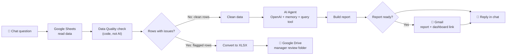

# 📊 Velora Superstore: Sales & Profit Analysis
### Power BI Dashboard + AI Reporting Assistant

---

## 🎯 Overview

An end-to-end analytics project on 2014–2017 retail transactions, built in two connected parts:

| Part | Question it answers | What I built |
|---|---|---|
| **1. Analysis & BI** | *Where does the business make or lose money?* | Python cleaning and EDA, SQL business questions, a 3-page Power BI dashboard |
| **2. AI automation** | *Can a manager ask a question and get a trusted answer?* | An n8n chat assistant with a data-quality gate, emailed reports, a manager review file in Google Drive, and a live interactive dashboard |

## 🔗 Quick Links

| | |
|---|---|
| 🔴 **Live interactive dashboard** | [i-ashish-07.github.io/Velora-Superstore-Project](https://i-ashish-07.github.io/Velora-Superstore-Project/) |
| 🤖 **n8n workflow files (JSON)** | [n8n-AI-Automation/workflows](https://github.com/i-ashish-07/Velora-Superstore-Project/tree/main/n8n-AI-Automation/workflows) |
| 🖼 **n8n workflow screenshots** | [n8n-AI-Automation](https://github.com/i-ashish-07/Velora-Superstore-Project/tree/main/n8n-AI-Automation) |
| 📊 **Power BI dashboard** | [Velora Superstore Dashboard.pbix](https://github.com/i-ashish-07/Velora-Superstore-Project/blob/main/Velora%20Superstore%20Dashboard.pbix) |
| 📄 **Dashboard & insights report** | [dashboard and insights.pdf](https://github.com/i-ashish-07/Velora-Superstore-Project/blob/main/dashboard%20and%20insights.pdf) |
| 📓 **Python notebook (cleaning & EDA)** | [e-commerce_project .ipynb](https://github.com/i-ashish-07/Velora-Superstore-Project/blob/main/e-commerce_projectt.ipynb) |
| 🗄 **SQL business questions** | [superstore questions.sql](https://github.com/i-ashish-07/Velora-Superstore-Project/blob/main/superstore%20questions.sql) |
| 📋 **Business questions** | [Business Questions](https://github.com/i-ashish-07/Velora-Superstore-Project/blob/main/Business%20Questions) |
| 🗂 **Dataset** | [Superstoree.csv](https://github.com/i-ashish-07/Velora-Superstore-Project/blob/main/Superstoree.csv) |

---

## 1. Business problem

> **High revenue does not always mean high profitability.**

An e-commerce retailer wants to know whether its sales are profitable, which products destroy margin, whether discounts are sustainable, and which regions turn sales into profit efficiently.

**Questions answered**
1. What is the overall sales and profit performance?
2. Which category drives the most revenue, and which has the best margin?
3. Which sub-category contributes most to losses?
4. Does discounting improve or damage profitability?
5. Which region converts sales into profit most efficiently?
6. What are the monthly seasonal trends in sales and profit?

**Headline numbers (Power BI dashboard)**
- **$2.30M** total sales, **$286K** total profit (about **12.4%** margin)
- **10K** orders from **793** customers
- **Technology** reaches a **17.40%** profit margin, and Technology and Office Supplies stay healthy while other categories lag

The full findings are in the [dashboard and insights report](https://github.com/i-ashish-07/Velora-Superstore-Project/blob/main/dashboard%20and%20insights.pdf).

---

## 2. Part 1 – Analysis & Power BI dashboard

**Process:** raw CSV → cleaning and EDA in Python → business questions in SQL → measures in DAX → 3-page Power BI dashboard.

**Page 1 – Executive Sales & Profit Performance**

**Page 2 – Profitability & Risk Analysis**

**Page 3 – Insights & Recommendations**

---

## 3. Part 2 – AI analytics assistant (n8n)

Part 1 answers the questions I thought of. Part 2 lets a manager ask **their own** questions in plain English and receive a report in their inbox, without opening a BI tool.

**How it works**
1. **Ask:** the user types a question in the n8n chat.
2. **Read:** the workflow loads the sales data from Google Sheets.
3. **Validate:** every row is checked by code (see section 4). Problem rows are separated out and clean rows continue.
4. **Analyse:** an OpenAI agent with conversation memory and a data query tool answers the question.
5. **Report:** an HTML report with findings and business recommendations is built.
6. **Deliver:** the report is **emailed through Gmail** with a link to the live dashboard, and the answer is **returned in the chat**.

**Main workflow**

**Dashboard workflow:** Webhook → Google Sheets → clean data → Build Dashboard → Respond. It generates the interactive dashboard as a web page.

**Query tool workflow:** the sub-workflow the AI agent calls to run calculations on the data.

Import the [workflow JSON files](https://github.com/i-ashish-07/Velora-Superstore-Project/tree/main/n8n-AI-Automation/workflows) into n8n and reconnect your own Google Sheets, Gmail, Google Drive and OpenAI credentials to run it.

---

## 4. Data quality gate and manager review

Real datasets are messy, and an AI should not silently change numbers a manager relies on. The validation is **plain, deterministic code** that flags problems and never edits the original data.

| Check | Examples caught |
|---|---|
| **Missing values** | blank Customer ID, Product ID, Order Date, Sales |
| **Duplicates** | identical rows, or the same Order ID + Product ID (the first copy stays, extras are flagged) |
| **Date problems** | unreadable dates, impossible years, ship date before order date, ship date 60+ days after order |
| **Impossible values** | negative sales, quantity ≤ 0, discount outside 0–1, profit higher than sales |
| **Text in number fields** | Sales stored as `$1,234.50` |
| **Extreme values** | absurd sales or quantities, judged on a log scale so normal large profits and losses are **not** flagged |

Dates on clean rows are standardised to `YYYY-MM-DD`, whatever the original format (`11-08-16`, `10/18/2015`, `04-20-2017`).

**Test run:** 2,010 rows in → **1,970 clean rows** continue to the AI agent → **40 flagged rows** are held back.

**What happens to the flagged rows**
1. They are converted to an **Excel file** (`Velora_Rows_For_Review.xlsx`).
2. The file is uploaded to a **Google Drive folder** owned by, or shared with, the manager or a senior reviewer. Row data is never sent by email.
3. Each row carries **Issue Count**, **Issue Types** and **Issue Details** columns, for example `Missing value [Customer ID]: Required field is empty`.

**Review loop.** The reviewer uses the `row_number` column to find the row in the source sheet:

| Decision | Action in the source sheet |
|---|---|
| Fix it | Correct the value. It passes the checks on the next run and joins the analysis |
| Accept as is | Type **Approved** in the *Review Status* column |
| Leave it out | Type **Rejected** in the *Review Status* column |

---

## 5. Interactive HTML dashboard

### 🔴 [Open the live dashboard](https://i-ashish-07.github.io/Velora-Superstore-Project/)

A self-contained dashboard (HTML + Chart.js) generated by the workflow and hosted on GitHub Pages.

- KPI cards for sales, profit, margin, units and the share of loss-making order lines
- **Red highlighting wherever money is lost** (profit lines, bars, KPI cards and table rows)
- Filters for year, region, category and segment, plus **click-to-filter** on any chart
- Trend, sub-category, region, segment and **discount-impact** charts
- **Product performance:** top 10 by profit, top 10 by sales, bottom 10 by profit
- Auto-generated **key insights** and **business recommendations**
- Light and dark mode

> The hosted page is a snapshot of the data at export time. The n8n dashboard workflow regenerates it live from the sheet.

---

## 6. Tech stack

| Area | Tools |
|---|---|
| Analysis | Python (Pandas, Matplotlib, Seaborn), Jupyter, SQL |
| BI | Power BI Desktop, DAX, Power Query |
| Automation & AI | n8n (chat trigger, webhooks, sub-workflows), OpenAI agent with memory |
| Delivery | Gmail, Google Sheets, Google Drive |
| Web | JavaScript, HTML/CSS, Chart.js, GitHub Pages |

## 7. Limitations

- The query tool sub-workflow reads the full sheet. Applying the same validation inside it would make every AI answer use only validated rows.
- Date parsing assumes month-first formats, which matches this dataset.
