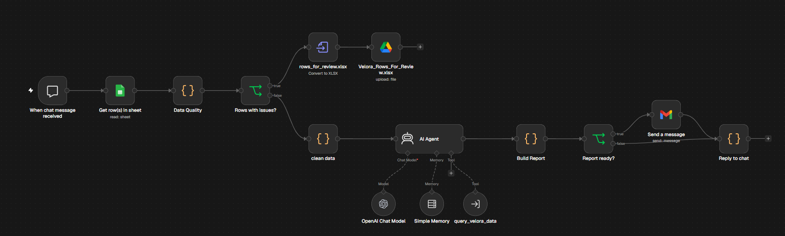
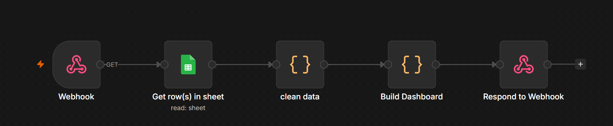
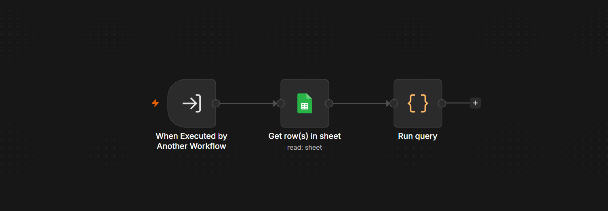

# 🤖 Velora AI Automation (n8n)

This folder holds the n8n workflows behind the AI reporting assistant. For the business problem, the Power BI analysis and the headline results, see the [main README](../README.md).

## What is in this folder

| File | What it is |
|---|---|
| `workflows/` | Importable n8n workflow JSON files |
| `velora_main_workflow.png` | Main workflow: chat → data quality gate → AI agent → report → Gmail and chat reply |
| `velora_dashboard.png` | Dashboard workflow: webhook → Google Sheets → clean data → build dashboard → respond |
| `detailed_analysis.png` | Query tool sub-workflow that the AI agent calls to run calculations |

## The three workflows

**1. Main workflow:** a chat message triggers the flow. It reads the data from Google Sheets, runs the data quality check, sends clean rows to an OpenAI agent (with memory and a query tool), builds an HTML report, emails it through Gmail and replies in the chat. Rows with issues go to a Google Drive review file instead.

**2. Dashboard workflow:** generates the interactive HTML dashboard as a web page from the sheet.

**3. Query tool workflow:** the sub-workflow the AI agent calls to run calculations on the data.

## Data quality gate

Validation is plain code, so it is deterministic and never edits the original data. In the full run on the Velora dataset, **9,994 rows → 9,986 clean rows to the AI agent → 8 flagged rows** held back for review.

| Check | Examples caught |
|---|---|
| Missing values | blank Customer ID, Product ID, Order Date, Sales |
| Duplicates | identical rows, or the same Order ID + Product ID (first copy stays, extras flagged) |
| Date problems | unreadable dates, impossible years, ship date before order date, ship date 60+ days after order |
| Impossible values | negative sales, quantity ≤ 0, discount outside 0–1, profit higher than sales |
| Text in number fields | Sales stored as `$1,234.50` |
| Extreme values | absurd sales or quantities, judged on a log scale so normal large profits and losses are not flagged |

Dates on clean rows are standardised to `YYYY-MM-DD`, whatever the original format.

### Manager review loop

Flagged rows are converted to `Velora_Rows_For_Review.xlsx` and uploaded to a Google Drive folder shared with the reviewer. Row data is never sent by email. Each row has **Issue Count**, **Issue Types** and **Issue Details** columns.

| Decision | Action in the source sheet |
|---|---|
| Fix it | Correct the value. It passes the checks on the next run |
| Accept as is | Type **Approved** in the *Review Status* column |
| Leave it out | Type **Rejected** in the *Review Status* column |

## Run it yourself

1. Import the JSON files from `workflows/` into n8n.
2. Reconnect your own credentials: **Google Sheets**, **Gmail**, **Google Drive** and **OpenAI**.
3. Point the Google Sheets nodes at your copy of the dataset ([`Superstoree.csv`](../Superstoree.csv)).
4. Set the Google Drive folder for the review file and the email address for reports.
5. Open the chat trigger and ask a question, for example *"Which sub-category loses the most money?"*

> Credentials are not stored in the exported JSON files. n8n asks you to reconnect them after import.

## Limitations

- The query tool sub-workflow reads the full sheet. Applying the same validation inside it would make every AI answer use only validated rows.
- Date parsing assumes month-first formats, which matches this dataset.
